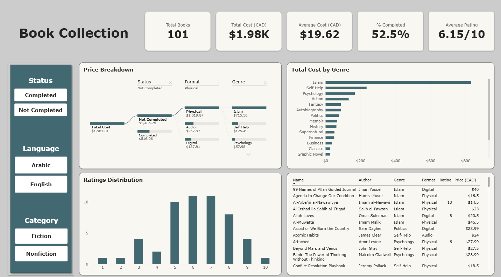

# Personal-Book-Collection
A database of my personal book collection, with details about each book and my status with the book. As well as a Power BI Interactive Dashboard on the data.

# Process
First, I made a database of all my books in Excel. It has 101 books, and each one has the name, author, format, language, year, page count, category, genre, price and whether I completed the book. I added my rating for only the books that I completed

I first tried to fill the details in automatically with a Python script that looks up ISBNs. It worked for some books, but the genres were messy and a lot of books came back with missing info. So I filled the data in myself instead.

Once I finished filling in all the book entries, I had to run through the database to fix any mistakes and errors in spelling and numbers, as well as making sure the data types were correct to each column.

After that I began building the dashboard. It has cards for total books, total cost, average cost, % completed and average rating. It also has a price breakdown tree, total cost by genre, average rating by genre, a ratings distribution of the books I've completed, and a table of all the books to scroll through. I added filters for status, language and category so you can click around and see different parts of the collection.

# Challenges
- The ISBN lookup script didn't work well enough, so I had to enter the data by hand which meant a lot of research and making sure to accurately write each book detail.
- The % Completed card showed 100% whenever I clicked a status filter. I wrote a DAX formula so it always compares against my whole collection, and it switches between % Completed and % Not Completed.

# Results
- I've spent $1,466 of my $1,982 total (about 74%) on books I haven't finished, even though I've finished 52.5% of my books by count. Two large Arabic books ($420 combined) make up a big part of that, but it still shows I should work through the books I already own before buying more.
- I have 101 books that cost about $1.98K in total, which is about $19.62 per book.
- I've finished 52.5% of them.
- My average rating is 6.15 out of 10, and 6 and 7 are the ratings I give most.
- Islam is the genre I spend the most on, around $830.
- History has my highest average rating, but some genres only have a few books, so those averages aren't very reliable.

# Things I can Improve
- About half my collection is single comic issues, which pull down the average price and page count. I want to add a column to separate books from comics.
- Some genres overlap (like Islam, Religion and Spirituality), so I'd like to clean those up.
- Add a date finished column so I can see how my reading changes over time.
- Create a proper script that produces all the book details from an ISBN code to automate the process for larger collections.
- Add insights based on page counts.

# Skills
- Microsoft Power BI
- DAX
- Data Cleaning
- Data Entry
- Microsoft Excel
- Data Visualization
